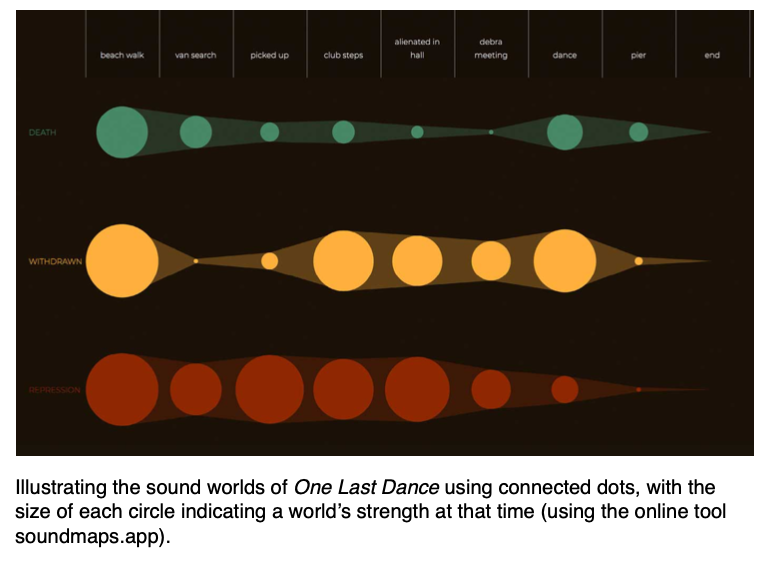
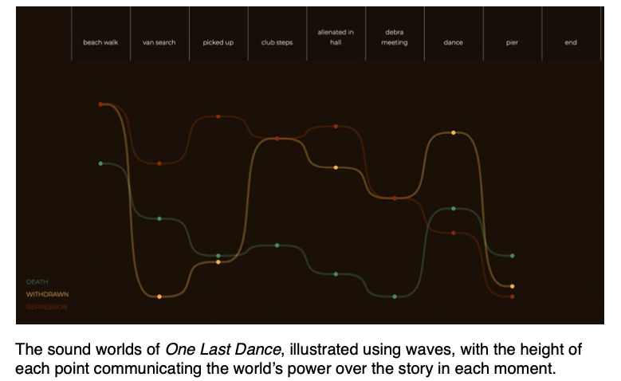
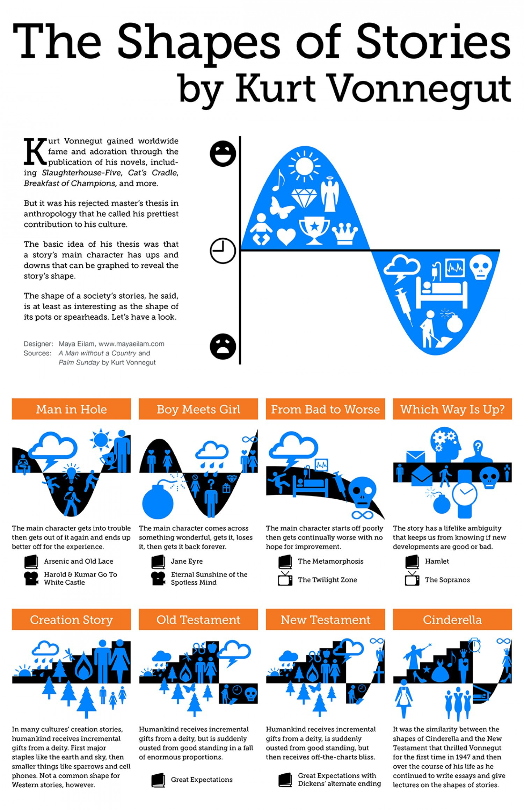

+++
title = "Shape: Sound Maps, Contrast and Motif"
outputs = ["Reveal"]
[reveal_hugo]
custom_css = "shape-slides.css"
slide_number = "c/t"
+++

# Shape

Sound maps, contrast and motif

Tim Harrison, *Sound Design for Film*, chapter 6

{}
Plan for one 50-minute meeting. Main lesson ends at the exit reflection; everything after the Appendix divider is optional. Keep visible slides student-facing and use these notes for facilitation.

Timing: goals and concepts 0–5 minutes; short example and A Quiet Place discussion 5–13; motif and Prowler comparison 13–26; contrast and Ran 26–38; design practice and peer feedback 38–48; exit reflection 48–50. Allow the full embedded Prowler pair, approximately 4:18 and 4:11. For Ran, use selected passages from the effects-led YouTube clip and the seven-minute music-led Film Secession excerpt as described in its notes. These are clip durations, not timestamps in the feature films. Each viewing includes spoilers; Ran depicts battle violence.
{}

---

## Today's goals

- Trace how a recurring sound gains meaning
- Explain a turning point through audible contrast
- Plan how sound changes across a sequence

Use a specific sound and moment as evidence.

{}
0–2 minutes including the title. Frame the distinction from Mood: today students will explain how an earlier sound prepares a later event, or how changing the treatment organizes a sequence. Outline the sequence: a short invented example and a familiar-film discussion, two clip comparisons with different purposes, then students' own plans.
{}

---

## Sound across a story

**Motif:** a recurring sound associated with a character, idea, or situation.

**Contrast:** a difference between sound states that makes a change perceptible.

**Foreshadowing:** an earlier detail prepares us for a later event.

{}
2–5 minutes. Introduce these terms briefly; the next example connects recurrence with foreshadowing. These devices can overlap. A motif may foreshadow something, but repetition alone does not guarantee foreshadowing. Contrast can involve density, texture, perspective, or the balance of music and effects as well as loudness. A routine repeating footstep is not automatically a narrative motif; students should explain the association it builds.
{}

---

## An earlier sound prepares a later event

Imagine a machine that must keep running.

1. A faint rattle interrupts its steady rhythm
2. The rattle returns more often as the machine struggles
3. The rattle stops, then the machine fails

The earlier pattern makes the sudden absence meaningful.

{}
5–6 minutes. This is an invented example, not a scene from a particular film. Keep the same identifiable rattle across the three moments. Its increasing recurrence establishes a problem, and its abrupt absence becomes a warning before the failure. The payoff depends on what we heard earlier. This demonstrates development across time rather than a sound simply taking on a different mood in another context. Keep it brief and move to students' own observations from A Quiet Place.
{}

---

## A Quiet Place: trace a sound

Choose a sound whose role develops across the film.

- Where is it introduced?
- What do we learn when it returns?
- What later event does it prepare us to understand?

Compare with a partner. Support your reading with specific scenes.

{}
### Run the discussion, 6–13 minutes

- Give pairs three minutes to choose a sound and trace its development. Use the completed screening and students' logs; no replay is planned.
- Take responses for four minutes. Ask for specific scenes and what each return adds to our understanding.
- Let students choose before naming the feedback example. Accept other sounds supported by evidence; there is no single required answer.
- Pair anyone who has not completed the film with someone who has.

### Possible answer: Regan's device feedback

Regan is the family's deaf daughter. The device her father has worked on progresses from apparent problem to clue to deliberate action.

| Story moment | Sound | What we learn |
|---|---|---|
| Regan tests the device | Electronic interference | It seems to malfunction |
| Creature encounter in the cornfield | Feedback distresses both | The sound affects the creature |
| Basement confrontation | Regan amplifies the feedback | She can use it against the creature |

Each return adds information and prepares the payoff. Distinguish what the audience can infer from what Regan understands at each point.

Accuracy reminder: the feedback is distinct from the low hum and total silence used for Regan's subjective listening perspective. The creature-disabling effect is fictional, not a normal property of an implant.

### Optional follow-up

If students identify the feedback, ask: "If the cornfield encounter were cut, would the ending feel earned? What evidence would we lose?"

Use this to deepen a response, not as another required task.

### Close with the Shape connection

Earlier sound events make a later action understandable. Recurrence establishes a motif; information planted for a later payoff provides foreshadowing.

If useful, connect to Assignments 5 and 6: an inventory asks what sounds are needed; a timeline asks when they matter and how they develop. A simple table is enough.

### Optional production context

- **Sound rules, pressbook p. 3:** Krasinski listed everyday noises as "safe sounds" and "unsafe sounds." After the feedback example emerges, connect it to the learned rule: sound attracts danger, but this particular sound becomes a defense. This reversal is our analysis, not the pressbook's account of these specific scenes.
- **Bridge to Ran, pressbook p. 14:** Krasinski avoided a continuous score and worked with Marco Beltrami on how much music to use and when. Choosing when music enters or gives way also shapes a sequence. Save this connection for the Ran discussion if time is short.

### Sources for preparation

- *A Quiet Place*, English pressbook, pp. 3 and 14: production context above.
- [Erik Aadahl and Ethan Van der Ryn on the device test](https://www.motionpictures.org/2019/02/oscar-watch-a-quiet-places-sound-designers-on-2/).
- [Cornfield feedback and sonic perspectives](https://www.asoundeffect.com/a-quiet-place-sound/).
- [Feedback and the creatures' vulnerability](https://www.comingsoon.net/horror/features/1176529-a-quiet-place-ii-sound-designers-discuss-using-sound-to-scare-the-bejesus-out-of-audiences).
{}

---

## Motif and recognition

Earlier in the semester, we heard the Imperial March from *Star Wars*: a musical theme associated with Darth Vader and the Empire.

Once that association is established, a later return can make us anticipate the character before we see them.

The next comparison follows the Prowler's signature sound as his relationship with Miles changes.

{}
Begin the 13–26 minute block with a brief Imperial March recall, then introduce the Prowler as Miles's pursuer and uncle Aaron. The two clips reveal identities in opposite directions: Miles recognizes Aaron, then Aaron recognizes Miles. Give only the context students need to follow this relationship. This comparison examines recognition, a change in the relationship, and the soundtrack's response; it is not another setup/payoff map of A Quiet Place.

Recall the August 28 slide, "A recurring theme can signal who holds power." Ask students what the Imperial March made them expect. Briefly recall its definition of leitmotif, then extend the question to a timbral signature in the Prowler's score. Recognition is the starting point; today's task is to explain what a return does in its new context. Reference: /lectures/week-1/silent-to-sound/.
{}

---



## The Prowler's sonic signature

First Miles recognizes his uncle. Later, Aaron recognizes Miles.

  

    <h3>1. Identity and chase</h3>
    <iframe width="432" height="243" src="https://www.youtube.com/embed/YOIGw1vl3mk" title="Prowler comparison 1: Miles discovers Aaron's identity and flees" allow="accelerometer; autoplay; clipboard-write; encrypted-media; gyroscope; picture-in-picture" allowfullscreen></iframe>
    <a href="https://www.youtube.com/watch?v=YOIGw1vl3mk">Open clip 1 on YouTube</a>
  

  

    <h3>2. Aaron recognizes Miles</h3>
    <iframe width="432" height="243" src="https://www.youtube.com/embed/TnRsauVJu7I" title="Prowler comparison 2: Aaron recognizes Miles and spares him" allow="accelerometer; autoplay; clipboard-write; encrypted-media; gyroscope; picture-in-picture" allowfullscreen></iframe>
    <a href="https://www.youtube.com/watch?v=TnRsauVJu7I">Open clip 2 on YouTube</a>
  

**Listen:** note the signature sound in the pursuit and a soundtrack change when Aaron recognizes Miles.

{}
13–26 minutes includes the preceding motif introduction, both clips, and the next discussion slide. The first is about 4:18; the second is about 4:11 and includes Aaron's death. Introduce the relationship explicitly: Aaron is Miles's uncle and the masked Prowler. In clip 1 Miles discovers Aaron's identity; in clip 2 Aaron discovers that the Spider-Man he is pursuing is his nephew and chooses to spare him. Warn that the second clip includes a shooting and death.

Listen for the signature's return, withdrawal, or replacement and identify the moment of the change. Do not assert that the later music is a melodic transformation of the same motif; that specific claim has not been established. Ask students for audible evidence of how the sequence develops rather than only naming its mood. Play one video at a time and pause it before starting the other.

Daniel Pemberton discusses making the signature sound with Brian Dougans in his own account: https://threadreaderapp.com/thread/1075816351611142144.html. It belongs to his score; do not describe it as a literal noise produced by the character's body or costume. The boundary between score and sound design is a useful connection to Mood. Scene context: https://www.youtube.com/watch?v=TnRsauVJu7I and the studio screenplay at https://origin-flash.sonypictures.com/ist/awards_screenplays/SV_screenplay.pdf?file=DOCUMENT.
{}

---

## Recognition changes the relationship

1. Identify the signature sound in the pursuit
2. Locate a soundtrack change when Aaron recognizes Miles
3. Explain how that change marks a turning point

How does the later scene change our response to the earlier sound?

{}
Take two evidence-based responses. Replay a short passage if students disagree about what they heard. Accept different emotional readings if supported by sound and context. If they only identify loudness, ask about timbre, rhythm, and the sounds around the signature. Keep the focus on this pair's distinct contribution: how an established sonic threat is handled when the pursuer recognizes a family member. Conclude in one sentence that sound can change with a relationship. Proceed to Ran for a change across whole soundtrack layers.
{}

---

## Contrast at a turning point

Recall Miles's leap in *Spider-Verse*: music and effects take turns directing our attention.

In *Ran*, compare effects-led combat with a sustained music-led massacre.

Track which layers lead and how that treatment changes our relationship to the action.

{}
26–38 minutes includes this slide, Ran, and its discussion. Introduce the scene: an elderly warlord's castle is attacked by his sons' armies. Students do not need the whole plot to compare soundtrack states. Warn briefly about battle violence. Connect to Mood: here the question is where the soundtrack changes and what that change does across time.

The class reached the Spider-Verse leap example in Mood but did not reach Aftersun. Recall the handoffs between the song, glass, and wind in the leap sequence. Ask students to name one moment when their attention shifted between music and effects. Extend that listening task to Ran: compare which layers lead in the two passages, then explain the larger change in perspective. These uploads are a comparison, not a verified continuous transition. Contrast can involve density, texture, perspective, or the balance between music and effects, as well as loudness. Reference: /lectures/week-8/sdff-chapter-4/.
{}

---



## Ran: contrasting battle treatments

**1. Battle effects:** listen to voices, weapons, and movement.

<iframe width="480" height="270" src="https://www.youtube.com/embed/IYdYoy-taO0" title="Ran: effects-led battle excerpt" allow="accelerometer; autoplay; clipboard-write; encrypted-media; gyroscope; picture-in-picture" allowfullscreen></iframe>

[Open clip 1 on YouTube](https://www.youtube.com/watch?v=IYdYoy-taO0)

**2. Music-led massacre:** [watch on Film Secession](https://www.filmsecession.com/exhibition/film-music/room/toru-takemitsu-and-japanese-film-music/media/akira-kurosawa-and-toru-takemitsu/details). Open the second video, **“Hell's Picture Scroll.”**

**Compare:** physical battle detail in clip 1 with the sustained orchestral treatment in clip 2.

{}
26–38 minutes includes setup, selected passages from both clips, and discussion. Start with about 60–90 seconds of the restored YouTube excerpt to establish effects-led combat. Then use about three minutes of the music-led passage in the second Film Secession video, captioned "Hell's Picture Scroll" in Ran. This is a comparison of two excerpts, not a verified continuous edit between them. Do not describe their upload boundaries as consecutive moments or promise that either contains the complete transition. The curated excerpt is predominantly musical; use it to examine that sustained treatment.

Context for the music-led castle massacre: "Hidetora is an aging warlord who has divided his power among his sons. Two of them turn against him. Their armies attack the castle where he has taken refuge, destroying his household and retainers. As he watches the destruction, his authority and his ability to make sense of events collapse."

Compare the prominence of voices, weapons, movement, and other physical effects in the first clip with Toru Takemitsu's orchestral treatment of the massacre in the second. Connect the music-led treatment to images of Hidetora witnessing the destruction. The interpretation for discussion is that the massacre becomes a nightmare as his grasp on the world breaks down. This is an expressive reading, not a claim that the music literally plays in his head or that the film clinically depicts a specific diagnosis.

The music also permits a distant, mournful view of the massacre, rather than immersion in individual impacts and cries. Ask whether students feel closer to Hidetora's distress, further from the physical fighting, or both. They should identify actual audible differences between the excerpts. The later gunshot discussed in the exhibition is background context, not a required cue to locate in these uploads.

The Shape connection is how a sustained change in sound treatment can organize a larger passage of a film. Effects-led action and a music-led massacre create different listening relationships to violence. Ask students to explain what replacing the effects with sustained music does across the passage, beyond simply identifying its mood. The comparison illustrates that design choice; it does not by itself document the exact transition in the feature.

Sources: Film Secession's scene analysis and excerpt at the viewing link; the official soundtrack booklet discusses the removal of ambient sound, orchestral texture, and distance from violence: https://www.silvascreen.com/wp-content/uploads/SILCD1518-RAN-DigitalBooklet.pdf. Further analysis: https://www.cambridge.org/core/journals/signs-and-society/article/hearing-transcendence-distorted-iconism-in-toru-takemitsus-film-music/870822DF66144D94EDE3E6800A4896D8.
{}

---

## Describe the contrast

Compare the two excerpts.

- Which physical sounds stand out in the first?
- What does the music lead you to notice in the second?
- How does that change relate to Hidetora's response?

Support your interpretation with an audible detail.

{}
Allow about two minutes. Put the contrast into words: effects-led combat versus a sustained music-led passage. Ask how the musical treatment relates to Hidetora's collapse, while allowing other interpretations supported by the excerpt. Ask how the scene might feel with uninterrupted realistic battle effects. There is no requirement to label the music simply sad or the effects simply realistic. A strong response describes a change and explains its effect on attention, distance, or emotion.
{}

---

## Plan sound across three scenes

Choose a film or episode you know well, other than today's examples.

1. Pick a setup, a turning point, and a payoff
2. Propose a sound to establish in the first scene
3. Plan how it returns, changes, or disappears in the later scenes

Sketch your plan on paper. Ask a partner whether the payoff is prepared, then revise one choice.

{}
38–48 minutes: allow five minutes to choose and plan, three minutes to compare with a partner, and two minutes to revise. This is a proposed sound redesign across several scenes of a familiar film or episode, not a reconstruction of its existing soundtrack. Students do not need footage, playback, REAPER, or precise timestamps. They can identify scenes by what happens in them.

Use a simple table with columns for scene, proposed sound treatment, and what the audience understands. Keep plot summaries to one sentence per scene. Ask students to choose connected moments involving the same character, relationship, or story problem. They can change the sound treatment while keeping those events intact. If someone cannot choose a film quickly, let them invent a three-scene story instead.

The first scene establishes an association or listening expectation. The later scenes should develop or challenge it, with a payoff that depends on the earlier setup. Students can alter timbre, rhythm, perspective, surrounding layers, or the presence of the sound. Repetition or increased loudness alone needs a narrative reason. Partners should identify what the first scene prepares them to understand later and suggest a revision if that connection is unclear.

This replaces the robot-animation exercise: its roughly 20-second runtime does not provide the extended narrative arc this task is intended to explore. The exercise plans relationships between scenes, as students will need to do in the final project. No new graded submission or finished audio is required.
{}

---

## Exit reflection

Which choice did you revise after your partner's feedback?

Explain how an earlier sound choice prepares a later moment in your plan.

{}
48–50 minutes. Take short verbal responses or a quick written reflection for discussion, with no new graded requirement. Look for a concrete revision and an explanation connecting two moments. Students should evaluate their existing plan rather than invent another example. If students only describe making it louder, ask why that change belongs at that particular moment. End the main lesson here.
{}

---

# Appendix

Optional examples and mapping references

Some clips reveal plot developments or depict violence.

{}
These slides extend or substitute for examples, rather than adding to the 50-minute plan. Each video has a direct YouTube link as well as an embedded player. Use a substitute only if its listening task serves the same learning goal.
{}

---



## A Man Escaped: anticipation

A prisoner watches for an opportunity to escape during a car journey.

**Listen for:** offscreen sounds that suggest what might happen next.

<iframe width="560" height="315" src="https://www.youtube.com/embed/vIux68hUlgY" title="A Man Escaped: opening car journey" allow="accelerometer; autoplay; clipboard-write; encrypted-media; gyroscope; picture-in-picture" allowfullscreen></iframe>

[Open on YouTube](https://www.youtube.com/watch?v=vIux68hUlgY)

{}
Approximately 1:56. Ask how sound directs attention beyond the frame. This opening excerpt alone cannot demonstrate every later return of a motif across the feature. Treat anticipation as a question about the excerpt, and reserve claims about a recurring bell across the whole film for a comparison with actual later scenes.
{}

---



## Akira: music and machines

The opening bike sequence introduces a distinctive musical and mechanical world.

**Listen for:** a sound you could recognize if it returned in another scene.

<iframe width="560" height="315" src="https://www.youtube.com/embed/rubRpPgbY_w" title="Akira: opening bike sequence" allow="accelerometer; autoplay; clipboard-write; encrypted-media; gyroscope; picture-in-picture" allowfullscreen></iframe>

[Open on YouTube](https://www.youtube.com/watch?v=rubRpPgbY_w)

{}
Approximately 1:14. Ask students to distinguish music from engine sounds and describe a candidate signature. Do not claim this short upload establishes the frequency or exact placement of either sound across the entire film. A hypothetical later return is a design proposal, not an observed event.
{}

---



## Vader: a character sound

Vader confronts an officer after a failed pursuit.

**Listen for:** how breath, voice, and music establish his presence.

<iframe width="560" height="315" src="https://www.youtube.com/embed/aV2DLkDPwM8" title="The Empire Strikes Back: Vader confronts an officer" allow="accelerometer; autoplay; clipboard-write; encrypted-media; gyroscope; picture-in-picture" allowfullscreen></iframe>

[Open on YouTube](https://www.youtube.com/watch?v=aV2DLkDPwM8)

{}
Approximately 1:11. Compare a bodily sound associated with a character to the Prowler's signature in the score. Ask what distinguishes the breath from dialogue and underscore. Use other appearances students know to support a broader motif claim; the excerpt establishes the sound's role in this scene.
{}

---



## Hot Fuzz: a verbal warning

At a village fete, an announcement precedes a violent death.

**Listen for:** a line whose meaning changes after the event.

<iframe width="560" height="315" src="https://www.youtube.com/embed/ds4NV7kZpYs" title="Hot Fuzz: village fete sequence" allow="accelerometer; autoplay; clipboard-write; encrypted-media; gyroscope; picture-in-picture" allowfullscreen></iframe>

[Open on YouTube](https://www.youtube.com/watch?v=ds4NV7kZpYs)

{}
Approximately 3:16. Contains graphic violence. The announcement about Tim's number is a verbal foreshadowing example; distinguish that semantic clue from the Prowler's timbral association. Ask which words become significant in retrospect and what the music contributes to anticipation. The original lesson's account supplies the context; students should identify the line in playback rather than being told its answer in advance.
{}

---



## Mapping sound worlds

Which sound world leads, and where does that change?

{}
Retained figure from the original chapter materials. Read scenes horizontally and sound worlds vertically. Circle size indicates relative prominence, not calibrated decibels. Ask students to describe one crossing or change. Their own maps can use words and a table instead.
{}

---



## Following a sound world's shape

Where does a world grow, fade, or give way to another?

{}
Retained figure from the original chapter materials. These shapes show a planning idea; they are not literal audio waveforms or measurements. Compare with the connected-circle view. Use only if students benefit from an alternate representation after making the simpler map.
{}

---



## Story structure reference

[Open the full-size image](stories.jpeg)

{}
Optional original reference. The tall image is a thumbnail on the slide; open the full-size image for its small labels. Avoid presenting one story arc as a rule every film must follow. Return to the question: which structural changes should become audible?
{}

---

## Further reading

- Tim Harrison, *Sound Design for Film*, chapter 6
- [Daniel Pemberton on the Prowler sound](https://threadreaderapp.com/thread/1075816351611142144.html)
- [Erik Aadahl and Ethan Van der Ryn on A Quiet Place](https://www.asoundeffect.com/a-quiet-place-sound/)

Compare the designers' accounts with what you heard in the films.
